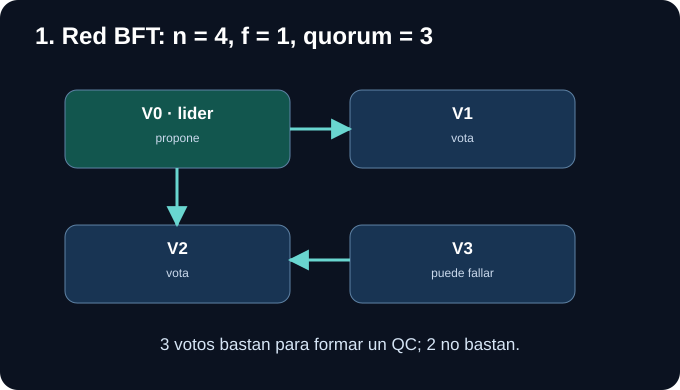
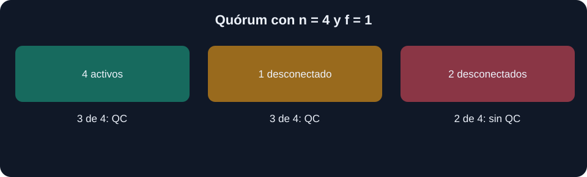
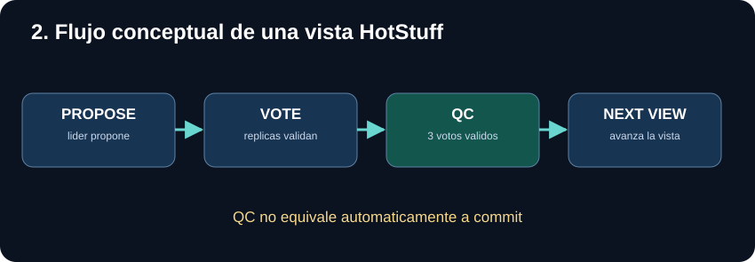
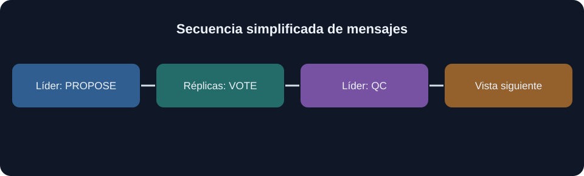
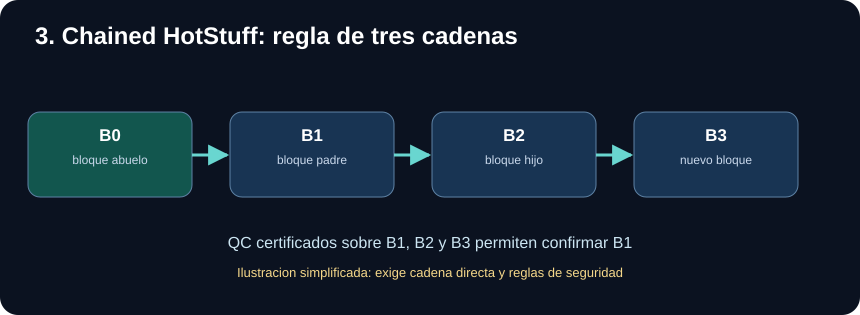
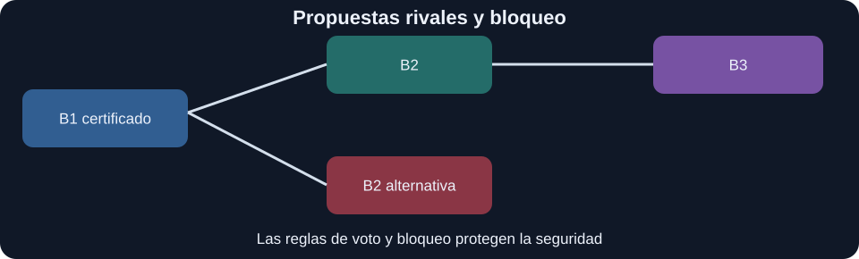
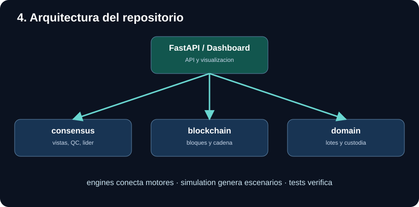
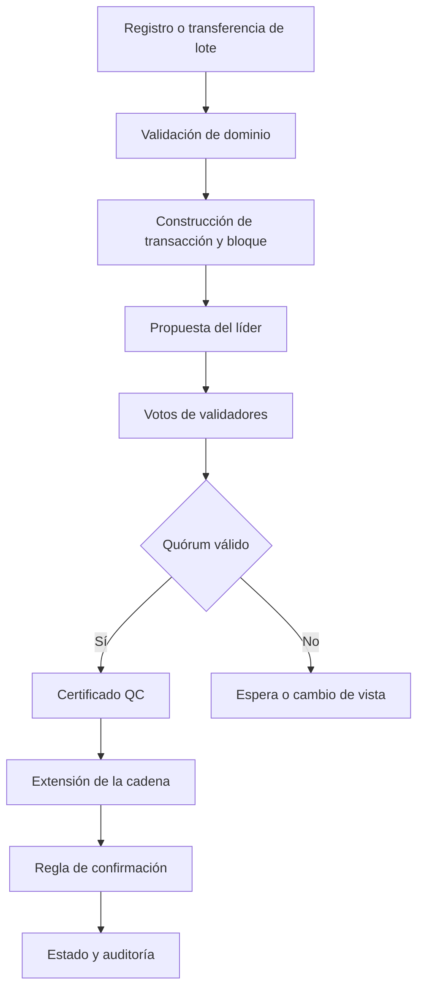
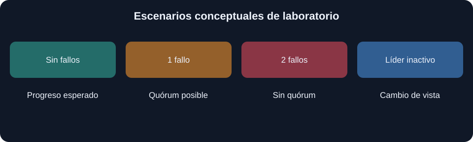

# 🧬 HotStuff-PharmaChain

## Consenso bizantino visual · Trazabilidad farmacéutica · Simulación y pruebas

[](https://www.python.org/)
[](https://fastapi.tiangolo.com/)
[](https://arxiv.org/abs/1803.05069)
[](#9-limitaciones-y-referencias)

**Laboratorio didáctico de consenso bizantino HotStuff aplicado a la
trazabilidad farmacéutica.** Incluye un paquete Python, simulaciones,
una API FastAPI y paneles de demostración.

> **Alcance:** es un proyecto de aprendizaje y experimentación. Las figuras
> describen el protocolo y su modelo; no prueban por sí solas que todas las
> garantías de un despliegue BFT de producción estén implementadas.

## 📊 Presentación del proyecto

Consulta la presentación académica de HotStuff-PharmaChain,
donde se explica el funcionamiento del consenso HotStuff,
Chained HotStuff, los ataques bizantinos y los casos reales.

📄 [Ver presentación en PDF](docs/tarea1_IagoOtero_AliciaJiaJun_Vigo_HotStuff.pdf)

## Índice

1. [El problema](#1-el-problema)
2. [Tolerancia bizantina](#2-qué-significa-tolerar-fallos-bizantinos)
3. [Cómo funciona HotStuff](#3-cómo-funciona-hotstuff)
4. [Chained HotStuff y la confirmación](#4-chained-hotstuff-y-la-confirmación)
5. [Arquitectura de PharmaChain](#5-arquitectura-de-pharmachain)
6. [Caso farmacéutico paso a paso](#6-caso-farmacéutico-paso-a-paso)
7. [Instalación y ejecución](#7-instalación-y-ejecución)
8. [Pruebas y experimentos](#8-pruebas-y-experimentos)
9. [Limitaciones y referencias](#9-limitaciones-y-referencias)

## 1. El problema

En una cadena de suministro farmacéutica, distintos participantes
(fabricante, distribuidor, farmacia) necesitan compartir un historial de
lotes y transferencias. Un registro compartido puede facilitar la auditoría,
pero debe resolver quién decide qué operación se incorpora y en qué orden.

HotStuff es un protocolo de consenso **BFT**: busca que las réplicas
honestas acuerden un historial compatible incluso si una parte de los
validadores falla o actúa maliciosamente. El consenso **no garantiza** que
un dato físico introducido por un participante sea verdadero: la autenticidad
de una entrega necesita controles externos.

### ¿Por qué no basta con una base de datos convencional?

Una base de datos centralizada puede ser suficiente cuando todas las
organizaciones confían en un único operador. PharmaChain estudia un
escenario distinto: varios participantes necesitan acordar el orden de
las operaciones sin delegar toda la decisión en una sola entidad.

| Necesidad | Qué aporta el sistema | Qué no garantiza |
| --- | --- | --- |
| Orden compartido | Consenso entre validadores | Datos físicos veraces |
| Auditoría | Historial de eventos y transferencias | Identidad real sin controles |
| Resistencia a fallos | Quórums y cambios de líder | Disponibilidad ilimitada |
| Trazabilidad | Cadena de custodia lógica | Autenticidad del medicamento |

## 2. Qué significa tolerar fallos bizantinos



En el ejemplo didáctico usamos **n = 4 validadores** y suponemos como máximo
**f = 1 validador bizantino**. En el modelo clásico de HotStuff:

- Se requiere `n >= 3f + 1`.
- Un certificado de cuórum (QC) requiere `2f + 1` votos válidos: **3**.
- Dos cuórums de 3 dentro de un conjunto de 4 se intersectan en al menos
  **2 validadores**; con como máximo un bizantino, al menos uno es honesto.
- Esa intersección ayuda a la seguridad, junto con las reglas de voto,
  bloqueo y verificación de certificados.

**Ejemplo:** si V3 se desconecta, V0, V1 y V2 todavía pueden reunir tres
votos. Si también se desconecta V2, solo quedan dos y no se alcanza QC.
Esto afecta al progreso, no implica que deba confirmarse una propuesta
contradictoria.

### El ejemplo de los votos, visualizado



Con cuatro validadores, tres votos pueden formar un QC. Si solo
quedan dos validadores disponibles, el protocolo debe evitar una
confirmación injustificada aunque ello detenga el avance.

### Seguridad frente a vivacidad

- **Seguridad (*safety*):** dos réplicas honestas no deben confirmar
  historiales incompatibles.
- **Vivacidad (*liveness*):** la red puede continuar avanzando bajo
  las hipótesis de sincronía eventual y líderes honestos suficientes.

Estas garantías requieren que la implementación respete el modelo
BFT y sus verificaciones; no se obtienen solo por usar cuatro nodos.

## 3. Cómo funciona HotStuff



Una **vista** (view) es una oportunidad para que un líder proponga un bloque.
En una ejecución conceptual:

1. **Selección del líder:** el protocolo asigna un líder a la vista actual.
2. **PROPOSE:** el líder propone un bloque que referencia su antecesor y
   aporta información justificativa, como un QC conocido.
3. **Verificación:** cada réplica revisa la propuesta, las reglas de seguridad
   y si puede votar sin violar su estado de bloqueo.
4. **VOTE:** las réplicas que aceptan envían votos autenticados.
5. **QC:** al reunir `2f + 1` votos válidos para la misma propuesta, se
   obtiene un certificado de cuórum.
6. **Progreso:** una nueva vista continúa la cadena; si el líder falla,
   el *pacemaker* impulsa el cambio de vista.

**No confundas tres estados:** propuesta recibida, bloque certificado por
QC y bloque definitivamente confirmado (*committed*). Un QC aislado no
basta para afirmar que el bloque ya es irreversible.

### ¿Qué sucede si el líder no responde?

Los validadores pueden agotar su temporizador y pasar a una nueva vista.
Los mensajes `NEW_VIEW` permiten comunicar el estado de progreso conocido.
El cambio de líder busca recuperar la **vivacidad**; las reglas de voto y
bloqueo preservan la **seguridad**.

### Línea temporal de una propuesta



El líder recibe votos de los validadores, construye un QC si reúne
las aprobaciones necesarias y lo utiliza para justificar el progreso.
Los votos deben referirse a la misma propuesta y superar las
verificaciones del protocolo.

### Ejemplo de cambio de vista

Supongamos que el líder de la vista 7 deja de responder. Los nodos
honestos agotan el tiempo de espera y anuncian su progreso mediante
`NEW_VIEW`. El siguiente líder debe construir una propuesta segura
a partir de la información justificativa disponible. **No basta con
elegir otro líder y descartar los QC anteriores.**

## 4. Chained HotStuff y la confirmación



En **Chained HotStuff** las fases se superponen entre bloques consecutivos:
en lugar de esperar a completar todas las fases de un bloque antes de
proponer otro, cada nueva propuesta extiende una cadena de bloques y QC.

En la formulación clásica de la **regla de tres cadenas**, cuando existen
tres bloques consecutivos correctamente enlazados y certificados conforme
a las reglas del protocolo, puede confirmarse el **abuelo** de la cadena.
La figura usa B1, B2 y B3 como esa secuencia: se confirma B1, no B3.

**Por qué es importante:** los QC proporcionan evidencia de votos y las
reglas de bloqueo impiden que un validador honesto apoye determinadas
ramas incompatibles. La confirmación no depende simplemente de sumar
votos sobre cualquier conjunto de bloques.

| Concepto | Interpretación |
| --- | --- |
| `view` | Número lógico de ronda o vista |
| `leader` | Validador que propone en esa vista |
| `vote` | Aprobación autenticada de una propuesta |
| `QC` | Certificado de un cuórum sobre una propuesta |
| `highQC` | QC más avanzado conocido por una réplica |
| `lockedQC` | Estado de bloqueo relevante para votar con seguridad |
| `commit` | Confirmación según la regla del protocolo |
| `pacemaker` | Coordina el avance de vistas y los tiempos de espera |

### HotStuff básico frente a Chained HotStuff

El esquema básico presenta fases explícitas, como PREPARE, PRE-COMMIT y
COMMIT. La versión encadenada **solapa** esas fases entre bloques, lo que
facilita el procesamiento en *pipeline*. No significa que desaparezcan
las comprobaciones de seguridad ni que cualquier tercer bloque produzca
una confirmación.

### Ejemplo razonado: tres enlaces certificados

1. Se propone **B1** y se obtiene un QC que certifica B1.
2. Se propone **B2**, hijo de B1, justificándolo con el QC anterior.
3. Se propone **B3**, hijo de B2, con su justificación correspondiente.
4. Cuando se observa la estructura de tres cadenas requerida, el
   protocolo puede confirmar **B1** según la regla clásica.

No se confirma B3 por el mero hecho de haber sido propuesto. Además,
la condición exacta depende de la variante de HotStuff y de cómo se
representan los QC en cada implementación.

### ¿Qué sucede con una bifurcación?



Dos propuestas rivales pueden existir temporalmente. El mecanismo
de bloqueo y la validación de QC restringen cuándo una réplica
honesta puede votar por otra rama. Una bifurcación visible **no
implica por sí sola** una violación de seguridad: el problema sería
confirmar dos historias incompatibles.

## 5. Arquitectura de PharmaChain



El repositorio contiene los siguientes módulos Python:

| Ruta | Función principal |
| --- | --- |
| `pharmachain/api/` | API y paneles de demostración |
| `pharmachain/blockchain/` | Representación de bloques y cadena |
| `pharmachain/consensus/` | Validadores, motor, vistas y seguridad |
| `pharmachain/domain/` | Modelos y transacciones farmacéuticas |
| `pharmachain/engines/` | Interfaces y adaptadores de motores |
| `pharmachain/simulation/` | Escenarios y red simulada |
| `tests/` | Pruebas automatizadas |

**Dos aplicaciones FastAPI distintas:**

- `pharmachain.api.main:app` expone el ejemplo de lotes y transferencias.
- `pharmachain.api.dashboard:app` expone la simulación distribuida,
  acciones sobre nodos y consultas de experimentos.

Estas interfaces no deben describirse como una única red real sin
comprobar cómo se conectan sus estados internos.

### Flujo conceptual de una operación



Este esquema es conceptual: la separación entre API, simulación y
estados internos depende de cada motor concreto del repositorio.

## 6. Caso farmacéutico paso a paso

**Escenario:** un fabricante registra el lote `MED-001` y después
transfiere su custodia a un distribuidor.

1. El fabricante solicita el registro del lote.
2. La capa de dominio valida la estructura de la transacción.
3. La simulación propone su incorporación a un bloque.
4. Los validadores honestos evalúan la propuesta y emiten votos.
5. Los QC y las reglas de commit determinan cuándo el bloque queda
   confirmado en el modelo de consenso utilizado.
6. Una transferencia posterior referencia el lote y actualiza la
   custodia según las reglas del dominio.

**Ataque a estudiar:** un validador intenta proponer una transferencia
conflictiva. El objetivo del experimento es observar si las verificaciones
de transacción y las reglas de consenso impiden una confirmación inválida.
El resultado concreto debe contrastarse con los eventos y las pruebas.

## 7. Instalación y ejecución

Requisitos: **Python 3.11 o superior**.

```bash
python3 -m venv .venv
source .venv/bin/activate
python -m pip install -e ".[dev]"
```

### Dashboard del consenso

```bash
python -m uvicorn pharmachain.api.dashboard:app --reload --port 8001
```

Panel: <http://127.0.0.1:8001/>.

Endpoints comprobados en el código de `dashboard.py`:

- `GET /api/simulation`: estado de la simulación.
- `POST /api/simulation/round`: ejecutar una ronda.
- `POST /api/simulation/disconnect`: desconectar un nodo.
- `POST /api/simulation/reconnect`: reconectar un nodo.
- `GET /api/attacks`: catálogo de ataques.
- `GET /api/benchmark`: consulta de benchmark.

El archivo `index.html` de la raíz también contiene una demostración web
independiente; se puede abrir directamente en el navegador.

## 8. Pruebas y experimentos

```bash
python -m pytest
pre-commit run --all-files
```

Para entender el consenso, reproduce por separado estas situaciones:

| Experimento | Qué observar |
| --- | --- |
| Operación normal | Propuestas, votos, QC y confirmaciones |
| Líder inactivo | Timeout, `NEW_VIEW` y nuevo líder |
| Nodo desconectado | Si todavía existe cuórum |
| Dos nodos desconectados | Pérdida de progreso por falta de votos |
| Equivocación | Propuestas conflictivas y auditoría de seguridad |
| Recuperación | Reincorporación y sincronización del nodo |

Estas filas son una **guía de lectura** de los escenarios, no resultados
medidos. Para afirmar tolerancia a ataques concretos, conserva evidencias
de ejecución, semillas, versiones y aserciones de pruebas.

### Interpretación de los experimentos



**Qué demostrar en una exposición:**

1. Ejecuta varias rondas sin fallos y muestra la evolución del QC.
2. Desconecta un validador y observa si siguen disponibles tres.
3. Desconecta un segundo nodo y explica la pérdida de vivacidad.
4. Provoca un líder inactivo y muestra `NEW_VIEW`.
5. Comprueba si aparecen confirmaciones conflictivas y conserva logs.

No se deben confundir las observaciones del simulador con una prueba
formal de tolerancia bizantina o con resultados de una red real.

## 9. Limitaciones y referencias

- Los diagramas son explicaciones conceptuales, no capturas de resultados.
- Las garantías BFT dependen de firmas, membresía, temporización y reglas
  de seguridad efectivamente implementadas.
- El consenso ordena registros; no certifica la veracidad física de los
  lotes, la temperatura o la identidad fuera del sistema.
- Antes de publicar resultados de rendimiento, ejecuta benchmarks
  reproducibles y documenta el entorno.

### Fuentes científicas y proyectos de referencia

1. Yin, M., Malkhi, D., Reiter, M. K., Gueta, G. G. y Abraham, I.
   (2019). *HotStuff: BFT Consensus with Linearity and Responsiveness*.
   PODC, pp. 347-356.
   [DOI](https://doi.org/10.1145/3293611.3331591) ·
   [Prepublicación](https://arxiv.org/abs/1803.05069).
2. [libhotstuff](https://github.com/hot-stuff/libhotstuff):
   implementación original de referencia.
3. [Relab HotStuff](https://github.com/relab/hotstuff):
   marco experimental modular con variantes de consenso.
4. Flow HotStuff: código de consenso de Flow.
   [Repositorio](https://github.com/onflow/flow-go/tree/master/consensus/hotstuff).
5. [Aptos Core](https://github.com/aptos-labs/aptos-core):
   implementación de referencia del ecosistema Aptos.
6. [Diem](https://github.com/diem/diem):
   repositorio histórico de LibraBFT / DiemBFT.
